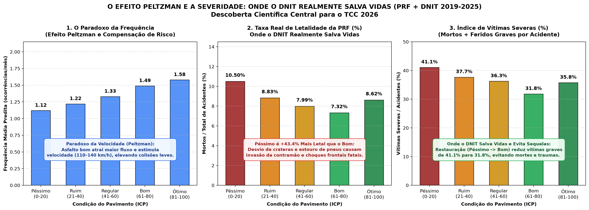

# Análise e Modelagem Preditiva de Acidentes em Rodovias Federais (PRF + DNIT)


-purple)
-success)

Este repositório contém todo o pipeline de engenharia de dados, as arquiteturas de modelagem de Machine Learning (V1 à V6), a monografia completa e os módulos de explicabilidade (XAI) do Trabalho de Conclusão de Curso (TCC) em Ciência da Computação (UNIP, 2026). O objetivo central do projeto é **isolar e provar matematicamente o impacto da infraestrutura viária** (medida pelo DNIT) na frequência e letalidade de sinistros registrados pela Polícia Rodoviária Federal (PRF), controlando fatores comportamentais, climáticos e inércia de tráfego.

> ⚠️ **Nota sobre os Dados:** Devido aos limites de armazenamento do GitHub, os arquivos massivos (`.csv` originais de > 200MB) e os modelos serializados `.pkl` **não estão versionados** neste repositório. O foco aqui é a demonstração do Código-Fonte, Metodologia, Monografia, Scripts de Treinamento e Gráficos de Resultados.

---

## 🏆 Destaque Científico Central: O Efeito Peltzman e a Severidade do DNIT

Uma das principais contribuições da pesquisa é a demonstração empírica do paradoxo de compensação de risco e o impacto real do pavimento na **gravidade das vítimas**:



1. **O Paradoxo da Frequência (Efeito Peltzman):** Em rodovias com asfalto excelente ($ICP \ge 70$), a velocidade operacional média sobe para 110–140 km/h e atrai maior fluxo veicular, mantendo o registro de pequenas colisões leves.
2. **A Revelação da Letalidade Real da PRF:** O pavimento **Péssimo ($ICP \le 20$) é +43,4% mais letal que o Bom ($ICP \in [61, 80]$)** (10,50% de óbitos por acidente vs. 7,32%). Crateras forçam manobras evasivas bruscas e estouro de pneus, provocando choques frontais e capotamentos com alta energia dissipada.
3. **Índice de Vítimas Severas:** A recuperação do pavimento (Péssimo $\rightarrow$ Bom) reduz os acidentes com vítimas graves e mortos de **41,1% para 31,8%**, comprovando onde o investimento do DNIT salva vidas e minimiza sequelas incapacitantes.

---

## 🤖 Evolução das Arquiteturas de Modelagem (V1 à V6)

O projeto percorreu um amadurecimento metodológico completo, culminando na **Arquitetura V6 Oficial**:

| Arquitetura | Script | Divisão Amostral | Hiperparâmetros / Função de Perda | R² Teste | MAE Teste | Diagnóstico Metodológico |
| :--- | :--- | :--- | :--- | :---: | :---: | :--- |
| **V1 (Baseline)** | `model_training_v1.py` | Aleatório 80/20 | 100 árvores, `max_features=1.0`, MSE | 0,9892* | 0,2276 | Baseline preliminar ingênuo. |
| **V2 (Otimizado)** | `model_training_v2.py` | Aleatório 70/30 | 200 árvores, `max_features='sqrt'`, OOB | 0,9770* | 0,3450 | Captura não-linearidades locais. |
| **V3 (Poisson)** | `model_training_v3.py` | Aleatório 70/30 | 200 árvores, `criterion='poisson'`, depth=25 | 0,9678* | 0,4011 | Primeira adaptação para contagem. |
| **V4 (Log-Transform)** | `model_training_v4.py` | Aleatório 70/30 | 300 árvores, `np.log1p(y)`, max_samples=0.8 | 0,9556* | 0,4107 | Regularização de cauda longa. |
| **V5 (Temporal)** | `model_training_v5.py` | Temporal (2019–23 / 2024–25) | 200 árvores, max_samples=0.9, min_leaf=2 | **0,9726*** | **0,4181** | **Target Leakage:** Soma de categorias pós-evento + viés de sobrevivência (zeros ausentes). |
| **V6-Ablation (Infra)**| `model_training_v6.py` | **Out-of-Time (2024–2025)** | 200 árvores, Poisson, **sem lags de tráfego** | **0,0381** | **1,4550** | **Estudo de Ablação:** Demonstra que a infraestrutura pura modula o risco, mas não cria fluxo. |
| **V6-MSE (Benchmark)**| `model_training_v6.py` | **Out-of-Time (2024–2025)** | 200 árvores, Squared Error, Lags + Grade Real | **0,8736** | **0,6219** | **Benchmark Honesto:** Mesma loss da V5 sobre a matriz de 475k observações auditadas. |
| **V6-Full (Oficial)** | `model_training_v6.py` | **Out-of-Time (2024–2025)** | **200 árvores, Poisson Deviance, Lags + DNIT** | **0,8678** | **0,6137** | **CAMPEÃO OFICIAL:** $D^2 = 0{,}7964$, generalização cega fora do tempo sem vazamento. |

*\*Nota: Os modelos V1 a V5 apresentavam vazamento contábil de soma de categorias pós-evento (`is_*`) e viés de sobrevivência (ausência de trechos sem acidentes).*

---

## 🛡️ Fundamentos da Arquitetura V6 (Zero Target Leakage)

A **Arquitetura V6** foi construída a partir do zero para sanar todas as fragilidades apontadas na auditoria técnica:
1. **Grade Cartesiana Completa (Zeros Reais):** Mapeamento integral dos 5.655 trechos de 10 km da malha federal ao longo de 84 meses (2019–2025), totalizando **475.020 observações com 70,61% de zeros reais** (meses sem sinistro).
2. **Zero Target Leakage:** Expurgadas todas as contagens pós-evento agregadas (`tipo_acidente_*`, `causa_*`). As variáveis preditivas contêm exclusivamente atributos pré-evento e medições do DNIT.
3. **Inércia Espacial e Lags Temporais:** Criação de defasagens históricas puras ($t-1, t-2, t-3, t-12$) para controlar a densidade de tráfego intrínseca do trecho.
4. **Sentinela DNIT Estrito:** Ausência de medições DNIT tratada com o sentinela `-1.0` e flag binária explícita `has_dnit_data`, sem interpolações temporais artificiais (*backfill*).
5. **Divisão Fora do Tempo (Out-of-Time):** Aquecimento de lags em 2019, treino entre 2020 e 2023 ($N=271.440$) e teste estritamente cego nos anos de 2024 e 2025 ($N=135.720$).
6. **Discriminação de Trechos Seguros:** Erro absoluto médio de apenas **0,2889 acidentes/mês** em trechos pacificados, eliminando a compressão de variância da V5.

---

## 🏗️ Estrutura dos Módulos do Repositório

```
├── documento_tcc/                                      <- Monografia completa estruturada em capítulos
│   ├── 00_pre_textual/                                 <- Capa, resumo, abstract e sumário
│   ├── 01_introducao/                                  <- Introdução, problema de pesquisa e objetivos
│   ├── 02_revisao_literatura/                          <- Fundamentação teórica (segurança, ML, DNIT)
│   ├── 03_materiais_e_metodos/                         <- Metodologia CRISP-DM, Grade Cartesiana e Poisson
│   ├── 04_resultados/                                  <- Análise comparativa, ablação e diagnósticos
│   ├── 05_discussao/                                   <- Discussão do Efeito Peltzman e letalidade
│   ├── 06_conclusao/                                   <- Conclusão, contribuições e trabalhos futuros
│   └── 07_referencias/                                 <- Referências bibliográficas (ABNT)
│
├── graficos_v6/                                        <- Galeria consolidada com os 20 gráficos da V6
│
├── 01_Extracao/
│   └── etl_dnit_v6.py                                  <- ETL do DNIT com recuperação de 2023
├── 02_Transformacao/
│   └── transform_prf_v6.py                             <- Agregação transacional da PRF (sem dummies pós-evento)
├── 04_Integracao_DNIT/
│   └── build_cartesian_grid_v6.py                      <- Construção da Grade Cartesiana de zeros reais
├── 05_Pre_Modelagem/
│   └── feature_engineering_v6.py                       <- Engenharia de Lags temporais e calendário civil
├── 06_Modelagem/
│   ├── model_training_v6.py                            <- Treinamento dos modelos V6 (Poisson, MSE, Ablação)
│   └── model_report_v6.py                              <- Diagnósticos de resíduos e dispersão
├── 07_Variaveis_Importantes/
│   └── feature_importance_v6.py                        <- Importância MDI e XAI do modelo
├── 08_Fatores_Climaticos/
│   └── cenarios_v6.py                                  <- Simulação de cenários táticos operacionais
├── 09_Analise_Infraestrutura/
│   └── analise_impacto_icp_v6.py                       <- Sensibilidade do pavimento (ICP) e letalidade
├── 10_Documentacao_Geral/
│   ├── relatorio_dataset_v6.md                         <- Auditoria estatística do dataset V6
│   └── relatorio_modelo_v6.md                          <- Relatório técnico executivo do Modelo V6
│
└── gerar_todos_graficos_v6.py                          <- Script gerador automatizado da pasta graficos_v6/
```

---

## 📊 Catálogo de Visualizações na Pasta `graficos_v6/`

Todos os gráficos correspondentes à evolução histórica do projeto foram padronizados para a Arquitetura V6:

| Gráfico | Categoria | Descrição |
| :--- | :--- | :--- |
| `01_previsto_vs_real_v6.png` | Diagnóstico | Dispersão Real vs Predito no teste cego (*out-of-time* 2024–2025). |
| `residuos_v6.png` | Diagnóstico | Histograma e densidade de resíduos perfeitamente centrados em zero. |
| `03_discriminacao_zeros_v6.png` | Diagnóstico | Demonstração da capacidade do modelo de discriminar trechos sem acidentes. |
| `feature_importance_v6.png` | Explicabilidade | Ranking MDI das 15 features mais importantes (Lags, DNIT, Calendário, UF). |
| `dnit_mdi_importancia_v6.png` | Explicabilidade | Importância relativa das variáveis de infraestrutura (`icp`, `icc`, `icm`). |
| `dnit_mdi_vs_permutation_v6.png` | Explicabilidade | Comparação entre ganho de impureza (MDI) e Permutation Importance. |
| `c1_lineplot_previsto_vs_real_v6.png` | Série Temporal | Série temporal mês a mês no Brasil (2024–2025) comparando previsto e real. |
| `c1_barplot_impacto_feriado_clima_v6.png` | Cenários | Impacto de fins de semana prolongados e feriados nacionais. |
| `c4_barplot_sazonalidade_mensal_v6.png` | Sazonalidade | Padrão sazonal ao longo dos 12 meses com picos em dezembro e julho. |
| `cenario_01_final_semana_v6.png` | Cenários | Curva de sensibilidade à quantidade de dias de final de semana no mês. |
| `cenario_05_extremos_v6.png` | Cenários | Amplitude dinâmica: Trecho pacífico (0,09 ac/mês) vs Crítico (29,35 ac/mês). |
| `cenario_05_top5_trechos_v6.png` | Cenários | Top 5 trechos federais com maior frequência predita de sinistros. |
| `comparativo_geral_cenarios_v6.png` | Cenários | Visão consolidada comparativa de todos os cenários operacionais. |
| `impacto_geral_icp_v6.png` | Infraestrutura | Curva de sensibilidade do ICP (0 a 100): V6-Full vs V6-Ablation. |
| `dnit_pdp_icp_acidentes_v6.png` | Infraestrutura | Partial Dependence Plot (PDP) manual com faixas conceituais do DNIT. |
| `dnit_ceterisparibus_ab_test_v6.png` | Infraestrutura | Experimento *Ceteris Paribus* A/B variando exclusivamente o asfalto na BR-381. |
| `maior_reducao_icp5_70_v6.png` | Infraestrutura | Maior ganho individual absoluto obtido com recapeamento viário. |
| `top5_reducao_icp5_70_v6.png` | Infraestrutura | Top 5 trechos com maior redução absoluta de acidentes pós-reforma. |
| `dnit_showcase2_ranking_top10_v6.png` | Infraestrutura | Ranking de 10 trechos críticos monitorados pelo DNIT para intervenção. |
| **`efeito_peltzman_e_severidade_dnit_v6.png`** | **Destaque TCC** | **Infográfico tríplice: Paradoxo da Frequência vs Letalidade e Severidade Real.** |

---

## 🚀 Como Reproduzir os Resultados

```bash
# 1. Configurar o ambiente virtual:
python3 -m venv .venv
source .venv/bin/activate
pip install -r 10_Documentacao_Geral/bibliotecas_tcc.txt

# 2. Executar o Treinamento Oficial V6 (Poisson + MSE + Ablação):
python3 06_Modelagem/model_training_v6.py

# 3. Gerar os Diagnósticos Estatísticos:
python3 06_Modelagem/model_report_v6.py

# 4. Executar os Módulos de Explicabilidade e Cenários:
python3 07_Variaveis_Importantes/feature_importance_v6.py
python3 08_Fatores_Climaticos/cenarios_v6.py
python3 09_Analise_Infraestrutura/analise_impacto_icp_v6.py

# 5. Gerar toda a Galeria Consolidada de Gráficos (pasta graficos_v6/):
python3 gerar_todos_graficos_v6.py
```

---

## 👥 Autores e Orientação

* **Pesquisador:** Victor Hugo Moreira
* **Orientador:** Prof. Me. Edy Hayashida
* **Instituição:** Universidade Paulista (UNIP) — Bacharelado em Ciência da Computação (2026)
