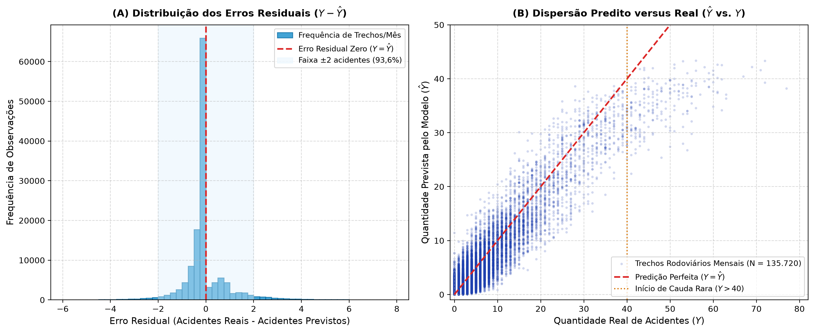

## 4.2 Diagnóstico do Modelo V6 Oficial

A avaliação da qualidade das estimativas do Modelo V6 Oficial envolve o diagnóstico detalhado dos erros de previsão no conjunto de teste independente (anos de 2024 e 2025). A Figura 18 apresenta o painel de diagnóstico dos resíduos, composto pelo histograma de erros e pelo gráfico de dispersão Predito versus Real, instrumentos fundamentais para verificar se o modelo comete desvios aleatórios ou sistemáticos e em quais faixas da distribuição esses desvios se concentram.

Figura 18: Análise de resíduos do Modelo V6 Oficial: histograma de erros e dispersão predito versus real.

Fonte: Elaborado pelo autor (2026).

O primeiro gráfico, correspondente ao histograma de resíduos, apresenta uma distribuição de erros fortemente concentrada em torno do zero, com média residual de +0,002 acidentes e mediana de -0,14. Do total de 135.720 observações avaliadas no teste, 84,0% dos erros absolutos situam-se em até 1 acidente e 93,6% estão contidos no intervalo entre -2 e +2 acidentes. Observa-se uma cauda alongada à direita, com pequenas ocorrências de erros positivos que chegam a aproximadamente +38,8 acidentes no caso do registro de pico máximo histórico (77 acidentes reais em um único mês). Esse comportamento decorre da assimetria dos dados, caracterizada por alta frequência de zeros e raridade de eventos múltiplos severos, contexto no qual o modelo tende a subestimar os picos atípicos.

Essa subestimação nos picos decorre do próprio mecanismo teórico do Random Forest detalhado no item 3.1.4. Como a predição final de regressão resulta da média das predições de todas as árvores individuais da floresta, o modelo promove uma suavização estatística natural na cauda extrema da distribuição.

O gráfico de dispersão Predito versus Real ajuda a compreender esse comportamento. Observa-se uma nuvem densa de pontos em estreita aderência com a linha diagonal de previsão perfeita ($Y = \hat{Y}$), que se estende por praticamente toda a faixa rotineira da malha rodoviária. Apenas a partir de 40 acidentes mensais nota-se um deslocamento sistemático em que as estimativas ficam abaixo da diagonal, reflexo da escassez amostral desses casos extremos, que representam somente 200 observações (0,15% da base de teste).

Do ponto de vista operacional nas rodovias brasileiras, os resultados da análise de resíduos trazem subsídios diretos para a tomada de decisão da PRF. O modelo apresenta alta precisão nos trechos de sinistralidade rotineira, exatamente onde a maior parte das decisões de alocação preventiva de recursos é tomada no dia a dia da instituição, e comporta-se de maneira conservadora nos trechos de sinistralidade extrema. Essa propriedade é adequada na rotina policial: qualquer segmento rodoviário projetado com 30 ou 40 acidentes mensais já é classificado compulsoriamente no topo de prioridade operacional, garantindo a mobilização de fiscalização reforçada independentemente da dispersão de valores nos picos isolados.
