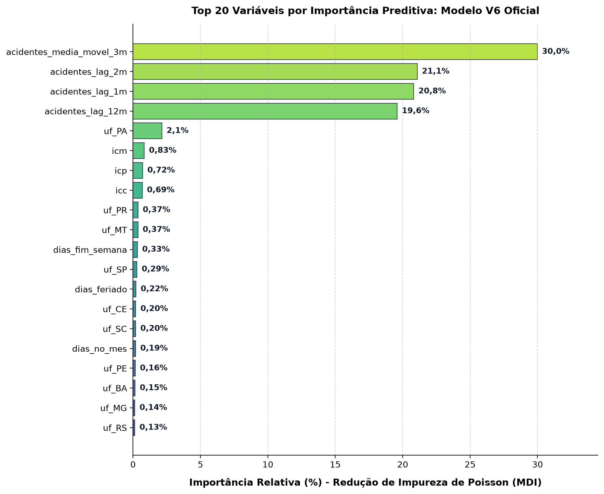

## 4.3 Análise de Importância das Variáveis

A Figura 19 apresenta o gráfico das vinte variáveis de maior importância preditiva no Modelo V6 Oficial, extraído por meio do atributo nativo `feature_importances_` do Random Forest. Esse indicador quantifica a contribuição média de cada variável na redução da impureza dos nós da floresta (Mean Decrease in Impurity - MDI), calculado sob a função de desvio de Poisson ao longo das 200 árvores do modelo.

Figura 19: Top 20 variáveis por importância preditiva no Modelo V6 Oficial.

Fonte: Elaborado pelo autor (2026).

A análise do gráfico revela uma hierarquia de importância com implicações teóricas e estratégicas diretas para os órgãos responsáveis pela segurança viária. O modelo é amplamente dominado pelo conjunto de variáveis defasadas (lags) e médias temporais geradas na engenharia de atributos: a média móvel dos últimos três meses (`acidentes_media_movel_3m`) lidera o ranking com 29,98% de importância, seguida pelo lag de dois meses (`acidentes_lag_2m`) com 21,08%, pelo lag de um mês (`acidentes_lag_1m`) com 20,81% e pelo lag homólogo de doze meses (`acidentes_lag_12m`) com 19,59%. Conjuntamente, esses quatro atributos temporais concentram 91,46% de todo o poder preditivo da floresta.

Esse resultado confirma a hipótese metodológica de que a sinistralidade em trechos rodoviários específicos de 10 km exibe forte dependência temporal e persistência estrutural. A média móvel e os lags recentes ancoram a tendência imediata do trecho, suavizando oscilações transitórias, enquanto o lag anual de 12 meses captura a sazonalidade periódica (como férias escolares e datas comemorativas recorrentes naquele mesmo ponto geográfico). Para a PRF, esse achado estabelece que o histórico recente consolidado do trecho físico é a fonte primordial de informação para antecipar a demanda de policiamento e socorro.

Entre as variáveis que não pertencem ao bloco de defasagens temporais, destaca-se a localização regional representada pelas unidades federativas. A variável `uf_PA` desponta na quinta posição geral, com 2,14% de importância, seguida por outros estados com expressivo volume de transporte de cargas e passageiros, como `uf_PR` (0,37%), `uf_MT` (0,37%) e `uf_SP` (0,29%). Esse comportamento decorre das disparidades macrorregionais de fluxo, da densidade de tráfego pesado e dos diferentes perfis operacionais das rodovias que cortam as diversas regiões do país.

Os índices de condição da infraestrutura provenientes da base do DNIT aparecem logo em seguida no ranking: o Índice de Condição da Manutenção (`icm`) contribui com 0,83%, o Índice de Condição do Pavimento (`icp`) com 0,72% e o Índice de Condição da Conservação (`icc`) com 0,69%, totalizando 2,24% de importância relativa. Embora esses percentuais pareçam modestos diante do peso predominante das séries temporais, trata-se do grupo de variáveis físicas contínuas de maior impacto no modelo, superando individualmente a quase totalidade das variáveis estaduais e de calendário. Esse resultado valida a estratégia de integração multi-fonte e comprova que a qualidade do pavimento e o estado de conservação exercem influência autônoma e mensurável sobre o risco de acidentes, justificando o aprofundamento analítico que será apresentado na Seção 4.4.

Por fim, as variáveis de calendário e exposição mensal completam o ranking das vinte mais relevantes: `dias_fim_semana` (0,33%), `dias_feriado` (0,22%) e `dias_no_mes` (0,19%), acompanhadas por outras unidades federativas como `uf_CE` (0,20%), `uf_SC` (0,20%), `uf_PE` (0,16%), `uf_BA` (0,15%), `uf_MG` (0,14%) e `uf_RS` (0,13%). As vinte principais variáveis respondem conjuntamente por 98,59% de toda a importância preditiva do Modelo V6 Oficial, demonstrando que a combinação de inércia temporal de curto prazo, ciclo anual, perfil regional, estado físico da via e densidade de dias críticos compõe uma representação abrangente e consistente da dinâmica de acidentes nas rodovias federais.
