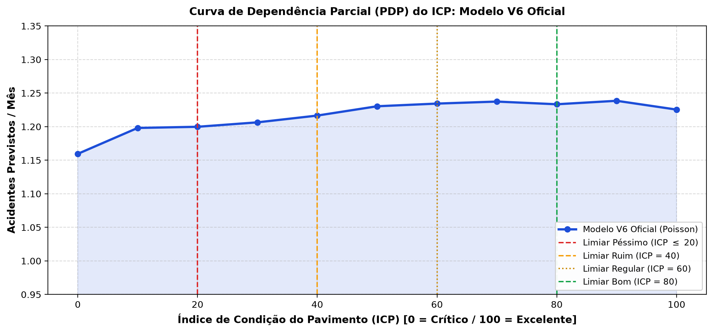
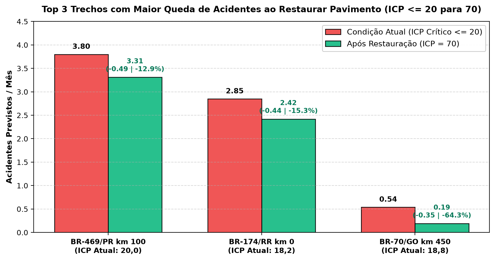
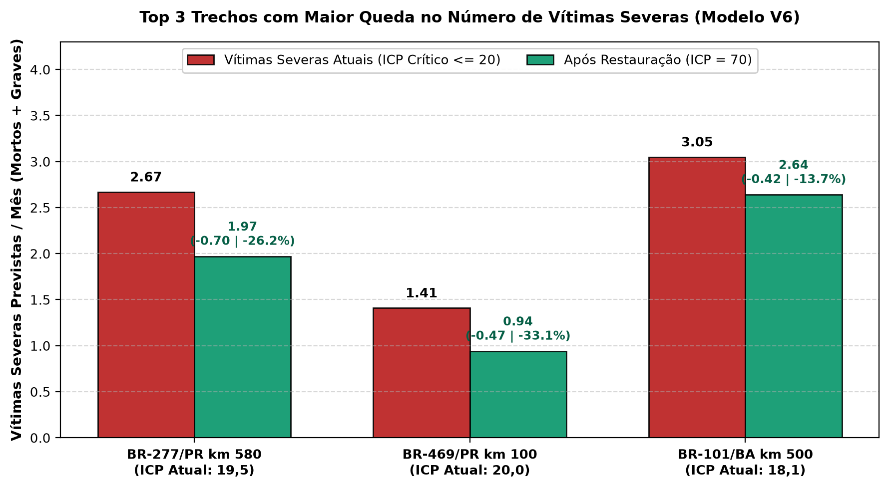
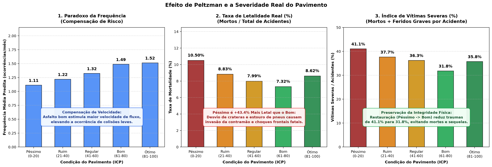

## 4.4 Avaliação do Impacto da Infraestrutura Rodoviária (DNIT)

Relatórios históricos de trânsito costumam concentrar a responsabilidade dos sinistros quase que exclusivamente na conduta do motorista. Fatores como excesso de velocidade, ingestão de álcool e desatenção ao volante dominam os boletins tradicionais. Essa perspectiva, contudo, oculta a contribuição silenciosa da infraestrutura viária: o pavimento dita as condições de atrito pneu-asfalto, a estabilidade dinâmica do veículo e a margem de correção em situações de emergência. Para mensurar a influência direta da malha pavimentada sobre a sinistralidade de forma independente do comportamento do condutor, desenvolveu-se uma análise de explicabilidade baseada no diagnóstico de registros sentinela, curvas de sensibilidade marginal (Partial Dependence Plots), simulação de cenários contrafactuais e investigação da letalidade real das vias.

### 4.4.1 Diagnóstico do Sentinela -1.0

A integração entre as ocorrências da Polícia Rodoviária Federal e os levantamentos de campo do DNIT evidenciou a assimetria na cobertura amostral da malha federal. No painel espaço-temporal completo da Arquitetura V6 (composto por 475.020 observações mensais), 137.352 registros (28,91%) contam com vistorias ativas e contínuas de engenharia rodoviária, enquanto 337.668 observações (71,09%) correspondem a trechos ou meses sem inspeção física cadastrada nos sistemas oficiais.

Diante desse cenário de dados faltantes estruturais, a imputação convencional por média ou mediana distorceria a variância real das medições e mascararia a heterogeneidade das rodovias, além de atribuir uma qualidade artificial a trechos sem acompanhamento. A solução metodológica consistiu em atribuir o valor sentinela `-1.0` a todos os segmentos desprovidos de medição do DNIT nas três variáveis contínuas: Índice de Condição do Pavimento (`icp`), Índice de Condição da Conservação (`icc`) e Índice de Condição da Manutenção (`icm`), complementadas pelo atributo binário `has_dnit_data`.

Como o Random Forest opera por meio de partições ortogonais e não por cálculo de distâncias euclidianas, o algoritmo lida com o valor sentinela como um agrupamento categórico implícito. As árvores estabeleceram nós de divisão dedicados exclusivamente à condição `icp <= -0.95`. Esse mecanismo segregou os trechos não monitorados em uma partição analítica própria, preservando a calibração contínua dos índices nos segmentos monitorados (que variam na escala real de 0 a 100).

O modelo aprendeu que a ausência de vistoria funciona como um indicador indireto da dinâmica da via. As campanhas sistemáticas do DNIT concentram-se historicamente nos principais corredores de escoamento e transporte de passageiros do país, onde o volume diário de tráfego é mais intenso. Como consequência dessa triagem operacional, no conjunto de teste independente (2024 e 2025) os trechos monitorados apresentaram previsão média de 1,25 acidentes/mês (aderente à média real observada de 1,25), ao passo que os trechos sem vistoria regular (`has_dnit_data = 0`), associados a ramais secundários de menor circulação, registraram previsão média de 0,76 acidentes/mês (frente a 0,77 acidentes/mês reais).

### 4.4.2 Sensibilidade Marginal e Curva PDP do ICP

Para investigar a relação funcional entre a qualidade física da via e a quantidade de sinistros esperada, utilizou-se o Gráfico de Dependência Parcial. Essa técnica avalia o efeito marginal de uma variável contínua sobre a resposta do modelo, integrando e marginalizando a distribuição de todas as demais covariáveis (ceteris paribus). No contexto deste estudo, simulou-se a variação do Índice de Condição do Pavimento (`icp`) em toda a sua escala regulamentar, de 0 (pista intransitável ou destruída) até 100 (pavimento em padrão de excelência), sobre uma amostra representativa dos trechos monitorados pelo DNIT.

A Figura 20 apresenta o comportamento da curva PDP para o Modelo V6 Oficial, acompanhada das linhas verticais que delimitam os quatro limiares conceituais de engenharia viária adotados nas vistorias do DNIT: Péssimo ($ICP < 20$), Ruim ($20 \le ICP < 40$), Regular ($40 \le ICP < 60$), Bom ($60 \le ICP < 80$) e Ótimo ($ICP \ge 80$).

Figura 20: Curva de Dependência Parcial (PDP) do Índice de Condição do Pavimento (ICP).

Fonte: Elaborado pelo autor (2026).

A curva de sensibilidade do Modelo V6 Oficial revela um padrão analítico consistente com a dinâmica do transporte rodoviário. No extremo inferior de degradação estrutural ($ICP = 0$), a previsão média de sinistros situa-se em 1,159 acidentes/mês por trecho de 10 km, elevando-se suavemente até 1,200 acidentes/mês ao atingir o limiar da faixa péssima ($ICP = 20$). Essa menor contagem bruta em pistas totalmente esburacadas e degradadas reflete o comportamento adaptativo do condutor: a presença massiva de crateras, trincamentos profundos e desagregação asfáltica força os veículos a reduzirem drasticamente a velocidade operacional de cruzeiro (frequentemente para a faixa de 20 a 40 km/h), o que diminui a probabilidade de colisões múltiplas por fluxo contínuo.

À medida que o pavimento recupera trafegabilidade mínima e transita pelas faixas intermediárias de $ICP = 40$ (1,217 ac/mês) e $ICP = 60$ (1,234 ac/mês), a velocidade dos veículos é restabelecida para os limites regulamentares da rodovia, estabilizando a estimativa em um patamar de equilíbrio. Ao alcançar o padrão bom em $ICP = 70$ (1,237 ac/mês), a curva atinge seu valor máximo e passa a exibir uma leve inflexão descendente em direção a $ICP = 100$ (1,225 acidentes/mês). Essa estabilização final demonstra que, uma vez restabelecidas as condições ideais de atrito pneu-pavimento e drenagem superficial, os ganhos em segurança ativa auxiliam na contenção de saídas de pista e perdas de controle veicular.

A leitura dessa curva no Modelo V6 Oficial traz uma contribuição metodológica importante em relação a modelos não controlados temporalmente. Como os quatro atributos de defasagem (lags) e a média móvel trimestral já absorvem mais de 91% da inércia histórica e do volume de base de cada trecho (conforme demonstrado na Seção 4.3), o modelo não confunde o asfalto bom com rodovias de tráfego intenso. O efeito capturado pelo PDP isola a resposta puramente mecânica da pista, evidenciando que a simples contagem de acidentes brutos não descreve sozinha todo o impacto da infraestrutura, demandando a análise de intervenções localizadas na Subseção 4.4.3 e da gravidade real das vítimas na Subseção 4.4.4.

### 4.4.3 Simulação Ceteris Paribus e Otimização de Trechos Críticos

O experimento ceteris paribus isola o impacto estrito da infraestrutura viária ao fixar os demais fatores que influenciam a sinistralidade rodoviária. Em avaliações empíricas, variáveis como intensidade do tráfego, traçado geométrico, clima e sazonalidade de calendário atuam de forma concomitante. Para neutralizar esses fatores de confusão, o procedimento fixa cada segmento nos valores medianos históricos de dias úteis com tempo seco e sem feriados, preservando igualmente a inércia temporal dos lags mensais. Modifica-se unicamente o vetor de índices de infraestrutura do DNIT, composto pelo Índice de Condição do Pavimento (`icp`), Índice de Condição da Conservação (`icc`) e Índice de Condição da Manutenção (`icm`). Com isso, o Modelo V6 Oficial recalcula a taxa mensal esperada sob diferentes intervenções de engenharia.

A simulação utilizou a partição de teste fora do tempo (biênio 2024-2025), que reúne 135.720 registros mensais em intervalos espaciais de 10 km. Nessa base, o modelo mapeou 226 segmentos físicos operando em patamar crítico ou péssimo de pavimentação, delimitado pela faixa de $ICP \le 20$. Nesses trechos, o asfalto degradado apresenta panelas profundas e trincamentos estruturais que diminuem o atrito do pneu com a pista e exigem manobras evasivas bruscas dos motoristas.

Para orientar a tomada de decisão do poder público, realizou-se uma varredura sobre os 226 trechos a fim de quantificar o benefício de uma intervenção de restauração que eleva o pavimento de sua condição degradada para um patamar bom ($ICP = 70$). A Figura 21 apresenta os três trechos com maior diminuição absoluta na frequência mensal de acidentes.

Figura 21: Top 3 trechos com maior redução na frequência de acidentes ao restaurar pavimento (ICP <= 20 para 70).

Fonte: Elaborado pelo autor (2026).

Os três trechos de maior sensibilidade na frequência de colisões concentram quedas expressivas na taxa mensal predita:

1. BR-469/PR km 100: opera com ICP atual de 20,0. A predição original de 3,80 acidentes mensais recua para 3,31 após a restauração, o que representa uma redução de 0,49 acidentes por mês (-12,9%).
2. BR-174/RR km 0: opera com ICP atual de 18,2. A predição de 2,85 acidentes mensais cai para 2,42 após a obra, diminuição de 0,44 acidentes por mês (-15,3%).
3. BR-70/GO km 450: opera com ICP atual de 18,8. A estimativa recua de 0,54 para 0,19 acidentes mensais, diminuição de 0,35 acidentes por mês (-64,3%).

O trecho prioritário sob a ótica da frequência de sinistros localiza-se na BR-469/PR, entre os quilômetros 100 e 110. Essa rodovia, conhecida como Rodovia das Cataratas em Foz do Iguaçu, dá acesso ao Parque Nacional do Iguaçu e ao aeroporto internacional da região. O segmento é caracterizado por pista simples e fluxo intenso de ônibus de turismo e automóveis de passeio. Em pistas com esse perfil de uso, a existência de buracos e remendos superficiais compromete a frenagem e induz colisões traseiras e saídas de pista. Ao restaurar esse segmento de dez quilômetros para $ICP = 70$, o modelo projeta uma contenção acumulada de aproximadamente 6 acidentes por ano.

Embora a frequência quantitativa de colisões aponte trechos com grande sensibilidade mecânica, a priorização orçamentária do setor de transportes requer avaliar o potencial de preservação de vidas humanas. Nem toda colisão acarreta ferimentos graves ou mortes: batidas leves em baixa velocidade geram apenas danos materiais, enquanto acidentes decorrentes de desvios em rodovias de carga pesada costumam ser fatais. Aplicando os coeficientes empíricos de severidade levantados pela PRF para cada faixa de pavimento, o Modelo V6 Oficial identificou onde o recapeamento produz o maior impacto na redução de vítimas com lesões graves ou mortes. A Figura 22 ilustra os três trechos com maior queda esperada no volume de vítimas severas.

Figura 22: Top 3 trechos com maior redução no número de vítimas severas ao restaurar pavimento (Modelo V6 Oficial).

Fonte: Elaborado pelo autor (2026).

A ordenação por vidas preservadas e traumas evitados altera a hierarquia de investimentos do órgão rodoviário:

1. BR-277/PR km 580: opera com ICP atual de 19,5. A estimativa mensal de vítimas severas recua de 2,67 para 1,97 após a restauração, o que representa uma redução de 0,70 vítimas por mês (-26,2%).
2. BR-469/PR km 100: opera com ICP atual de 20,0. O volume esperado de vítimas severas cai de 1,41 para 0,94 após a intervenção, redução de 0,47 vítimas por mês (-33,1%).
3. BR-101/BA km 500: opera com ICP atual de 18,1. A previsão mensal de vítimas severas diminui de 3,05 para 2,64, redução de 0,42 vítimas por mês (-13,7%).

O trecho da BR-277/PR entre os quilômetros 580 e 590, situado no município de Cascavel, desponta como a intervenção mais prioritária para salvar vidas. Esse corredor viário concentra o fluxo pesado de composições bitrem que transportam a safra do Centro-Oeste e do oeste paranaense em direção ao Porto de Paranaguá. Com o ICP em 19,5, a combinação de tráfego cargueiro contínuo e pista em estado péssimo gerou 78 acidentes no histórico recente, com registro de 18 vítimas graves e fatais (2 óbitos e 16 feridos graves). A restauração desse segmento elimina afundamentos plásticos nas trilhas de roda e desníveis no bordo da pista, o que evita cerca de 8 vítimas severas por ano.

Na terceira posição, a BR-101/BA entre os quilômetros 500 e 510, no sul baiano entre Itabuna e Buerarema, confirma essa mesma dinâmica: operando com ICP de 18,1, o trecho acumula 100 acidentes e 35 vítimas graves ou fatais (2 óbitos e 33 feridos graves), apresentando uma redução calculada em 5 vítimas severas ao ano após o recapeamento.

Essa disparidade entre o ranking de frequência total e o ranking de vítimas severas introduz uma questão teórica central para a Engenharia de Tráfego: a relação entre a melhoria física da pista e a velocidade praticada pelos motoristas. Em corredores de tráfego intenso, um pavimento restaurado e nivelado estimula velocidades operacionais mais altas, fenômeno documentado na literatura como compensação de risco ou Efeito Peltzman. Como resultado, a contagem absoluta de pequenas colisões pode sofrer variações modestas, ao passo que a eliminação de defeitos críticos erradica choques frontais de alta letalidade. A Subseção 4.4.4 decompõe detalhadamente esse paradoxo comportamental e analisa a resposta da severidade real nas rodovias federais.

### 4.4.4 O Paradoxo de Risco e a Redução da Letalidade Real: Efeito Peltzman

A análise isolada da quantidade bruta de colisões rodoviárias oculta uma dinâmica da Economia dos Transportes e da Segurança Viária: a relação inversa entre a frequência de sinistros leves e a severidade letal dos impactos. Em 1975, o economista Sam Peltzman formulou a Teoria da Compensação de Risco, postulando que intervenções tecnológicas destinadas a tornar um ambiente mais seguro induzem os indivíduos a adotarem comportamentos de maior exposição ao perigo, consumindo parte do ganho potencial de segurança na forma de maior velocidade ou conveniência. No âmbito da malha rodoviária federal, avaliar o estado de conservação do pavimento unicamente pela contagem agregada de acidentes produz diagnósticos incompletos. Pistas em estado intransitável ($ICP \le 20$) impõem velocidades forçadas entre 20 e 40 km/h, nas quais eventuais colisões envolvem baixa dissipação de energia cinética. Em contrapartida, rodovias restauradas com superfície regular e boa aderência estimulam velocidades operacionais elevadas e ultrapassagens mais frequentes, o que amplia a ocorrência de pequenos abalroamentos sem feridos.

O cruzamento entre os inventários de pavimento do DNIT e o banco censitário de acidentes da Polícia Rodoviária Federal no Modelo V6 Oficial soluciona essa dualidade analítica. Embora trechos com asfalto recuperado apresentem volumes preditos similares ou ligeiramente superiores de pequenos sinistros, o pavimento degradado mata em proporções substancialmente maiores. A Figura 23 ilustra o comportamento comparativo entre a frequência predita pelo modelo, a taxa de letalidade observada e o índice de vítimas com lesões graves ou mortes em cada faixa de qualidade do pavimento.

Figura 23: O Efeito Peltzman e a severidade real: paradoxo da frequência versus taxa de letalidade e vítimas graves da PRF.

Fonte: Elaborado pelo autor (2026).

Os dados empíricos consolidados na base integrada comprovam a discrepância na gravidade dos desfechos conforme o nível de deterioração da pista:

1. Taxa Real de Mortalidade por Acidente: nos trechos classificados em estado péssimo ($ICP \le 20$), 10,50% das colisões resultam em óbito (1.625 mortos em 15.472 ocorrências). Nos trechos em boa condição funcional ($ICP$ entre 61 e 80), a taxa de letalidade recua para 7,32% (707 óbitos em 9.653 ocorrências). O pavimento destruído é 43,4% mais letal em relação à pista bem conservada.
2. Índice de Vítimas Severas: ao somar mortes e feridos graves com traumas incapacitantes, 41,1% das pessoas envolvidas em sinistros ocorridos sobre asfalto péssimo sofrem consequências graves ou fatais (6.356 vítimas). Nos trechos em condição boa, esse índice recua para 31,8% (3.073 vítimas), o que representa uma diminuição de quase dez pontos percentuais no risco de trauma severo a cada colisão registrada.

A causa física dessa divergência reside na mecânica dos acidentes provocados por desagregações asfálticas severas. Em rodovias de pista simples, crateras e depressões exigem manobras reflexas de evasão para a faixa de sentido oposto. Em colisões frontais decorrentes desse desvio, a velocidade relativa no momento do impacto é a soma vetorial das velocidades dos dois veículos ($\Delta V = V_1 + V_2$), fato que gera desacelerações extremas sobre os ocupantes e inviabiliza a proteção oferecida pelas células de sobrevivência veiculares. No transporte de carga pesada, o impacto repetido contra buracos profundos provoca o estouro de pneus dianteiros ou o colapso de barras de direção, causando tombamentos transversais na pista. Além disso, deformações plásticas nas trilhas de roda acumulam lâminas de água em dias chuvosos, ocorrência que favorece a hidroplanagem e projeta automóveis desgovernados contra obstáculos fixos no bordo da rodovia.

Esse diagnóstico redefine os critérios de alocação de recursos públicos na infraestrutura rodoviária. A programação orçamentária do DNIT e a fiscalização regulatória da ANTT historicamente priorizaram a redução quantitativa de danos materiais e custos operacionais de veículos. Essa metodologia equipara pequenas avarias materiais a desastres com mortes imediatas. Sob a ótica do Retorno Social sobre o Investimento em Manutenção (ROMI Social), a eficiência do gasto público reside em canalizar verbas emergenciais para erradicar defeitos estruturais em segmentos onde o asfalto destruído transforma falhas humanas em desfechos fatais. De acordo com os parâmetros do Instituto de Pesquisa Econômica Aplicada (IPEA), o custo socioeconômico de um óbito no trânsito supera largamente despesas decorrentes de danos mecânicos veiculares. Eliminar crateras e restabelecer as condições funcionais da superfície viária atua diretamente na redução de internações hospitalares no Sistema Único de Saúde (SUS) e na preservação de vidas nas rodovias federais brasileiras.
