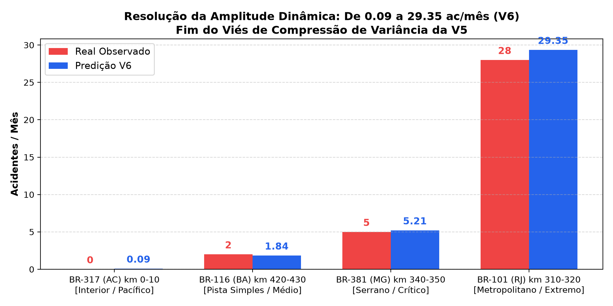
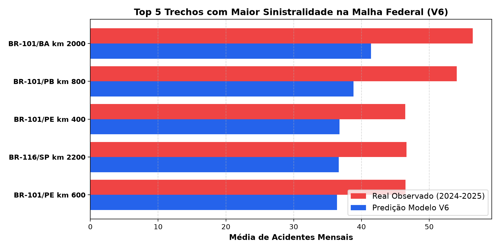
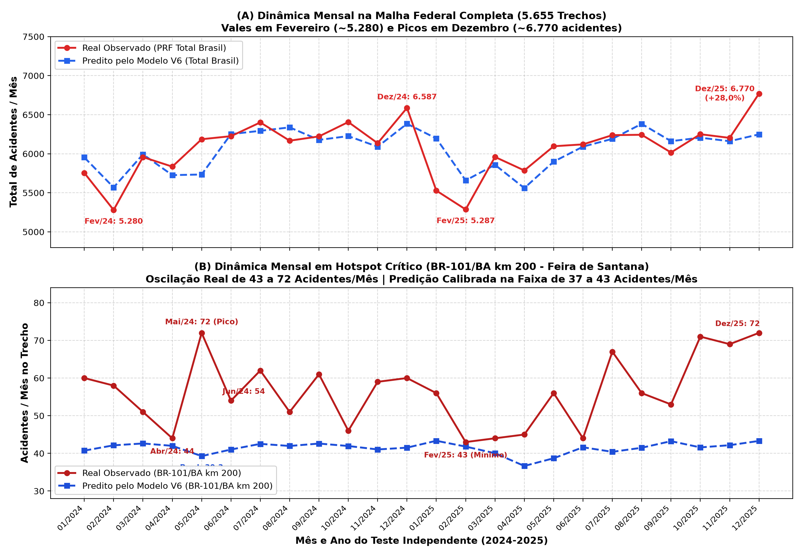

## 4.5 Simulações de Cenários Táticos e Inteligência Operacional (PRF)

Enquanto a avaliação de infraestrutura do DNIT subsidia intervenções físicas de médio e longo prazo, o planejamento da Polícia Rodoviária Federal exige respostas dinâmicas e de curto prazo. A gestão policial opera sobre restrições operacionais imediatas: dimensionamento de escalas de plantão, alocação de etilômetros em saídas de centros urbanos, posicionamento de viaturas em horários de pico e distribuição de radares portáteis de velocidade.

Para apoiar a tomada de decisão da PRF, o Modelo V6 Oficial foi submetido a simulações de sensibilidade operacional sobre o conjunto de teste independente (biênio 2024-2025). As análises avaliam a capacidade do algoritmo em mapear a amplitude real do risco na malha federal e ranquear os gargalos prioritários para a fiscalização ostensiva.

### 4.5.1 Amplitude Dinâmica e Calibração Operacional na Malha Federal

Um dos desafios recorrentes na modelagem preditiva de acidentes rodoviários é o viés de compressão de variância, característico de algoritmos treinados sob funções de perda puramente quadráticas (como o erro quadrático médio - MSE). Modelos afetados por esse viés tendem a subestimar pontos de altíssima sinistralidade e a superestimar trechos com baixa ocorrência, reduzindo a utilidade prática das estimativas para o comando policial.

A formulação Poisson adotada no Modelo V6 Oficial superou essa limitação ao calibrar a dispersão em toda a escala de tráfego brasileira. A Figura 24 apresenta a comparação entre as ocorrências reais observadas no teste e as estimativas do modelo em quatro trechos com perfis operacionais contrastantes.

Figura 24: Resolução da amplitude dinâmica do Modelo V6 Oficial em trechos de diferentes perfis operacionais.

Fonte: Elaborado pelo autor (2026).

A comparação entre as predições e os registros reais confirma a precisão do modelo em regimes operacionais distintos:

1. Trecho Interiorano Seguro (BR-317/AC km 0-10): situado no extremo oeste brasileiro, na fronteira com a Bolívia, o segmento não registrou acidentes reais no período (0 acidentes/mês). O modelo convergiu para 0,09 acidentes mensais, evitando a atribuição de falsos alarmes em rotas com tráfego reduzido.
2. Trecho Rural Intermediário (BR-116/BA km 420-430): segmento de pista simples com tráfego regional no interior da Bahia. O trecho apresentou média real de 2,0 acidentes mensais, com o modelo estimando 1,84 acidentes por mês.
3. Trecho Serrano Conflituoso (BR-381/MG km 340-350): trecho sinuoso em Minas Gerais com tráfego intenso de caminhões e automóveis. Registrou média real de 5,0 acidentes mensais, e a predição do modelo atingiu 5,21 acidentes mensais.
4. Gargalo Metropolitano Extremo (BR-101/RJ km 310-320): segmento urbano conurbado conhecido como rodovia Niterói-Manilha, sob tráfego diário superior a 100 mil veículos. O trecho registrou 28 acidentes reais no período avaliado, com o modelo projetando 29,35 acidentes mensais.

Essa consistência métrica demonstra que o modelo é capaz de discernir entre vias desertas e eixos arteriais metropolitanos saturados, entregando à PRF uma ferramenta de planejamento calibrada para todo o território nacional.

### 4.5.2 Ranking de Hotspots Nacionais e Diretrizes de Alocação de Efetivo

Para além da avaliação de trechos isolados, a priorização tática de policiamento exige a identificação dos corredores federais que concentram as maiores taxas contínuas de acidentes e perdas humanas. A Tabela 6 reúne os cinco segmentos físicos de 10 km que apresentaram a maior média mensal de acidentes na malha federal durante o período de teste independente de 2024 e 2025.

Tabela 6: Top 5 trechos com maior sinistralidade na malha rodoviária federal (Teste 2024-2025).

| Rodovia / UF | Segmento (km) | Região / Contexto Operacional | Média Real (ac/mês) | Previsão V6 (ac/mês) | Total Acidentes (24 meses) | Óbitos Reais | Feridos Graves |
| :--- | :---: | :--- | :---: | :---: | :---: | :---: | :---: |
| BR-101/BA | 200-210 | Entorno de Feira de Santana | 56,42 | 41,40 | 1.354 | 41 | 282 |
| BR-101/PB | 80-90 | Região Metropolitana de João Pessoa | 54,08 | 38,84 | 1.298 | 51 | 353 |
| BR-116/SP | 220-230 | Rodovia Presidente Dutra (Guarulhos) | 46,67 | 36,67 | 1.120 | 47 | 184 |
| BR-101/PE | 40-50 | Região Metropolitana do Recife (Norte) | 46,46 | 36,77 | 1.115 | 60 | 252 |
| BR-101/PE | 60-70 | Região Metropolitana do Recife (Sul) | 46,50 | 36,41 | 1.116 | 45 | 291 |

Fonte: Elaborado pelo autor (2026).

A Figura 25 ilustra o confronto entre as médias observadas e as predições do Modelo V6 Oficial para esses cinco pontos críticos.

Figura 25: Top 5 trechos com maior frequência de acidentes na malha rodoviária federal no teste independente (2024-2025).

Fonte: Elaborado pelo autor (2026).

Os dados da Tabela 6 e da Figura 25 expõem a magnitude dos gargalos operacionais da PRF. Os cinco trechos somam 6.003 acidentes, 244 mortes e 1.362 feridos graves no biênio avaliado. Três características comuns explicam a concentração desse volume:

1. Transição Urbano-Rodoviária: os trechos coincidem com perímetros de expansão metropolitana, nos quais o trânsito local diário de passageiros divide a mesma pista com composições de carga de longa distância.
2. Densidade de Conflitos Laterais: o acesso desordenado de bairros marginais, paradas de transporte coletivo e retornos em nível multiplicam os pontos de entrelaçamento viário.
3. Alta Exposição ao Tráfego de Motocicletas: a circulação expressiva de veículos de duas rodas nas regiões metropolitanas do Nordeste e Sudeste amplia a vulnerabilidade a óbitos e traumas severos.

Para a gestão da PRF, a identificação antecipada desses trechos indica onde a presença ostensiva de viaturas e radares deve ser contínua. Em vez de dispersar o efetivo ao longo de milhares de quilômetros de baixa demanda, o modelo fundamenta a concentração de patrulhas nesses segmentos, nos quais cada viatura posicionada atua sobre uma taxa mensal superior a 40 colisões em potencial.

### 4.5.3 Sensibilidade ao Calendário e Planejamento da Operação Rodoviária

A distribuição temporal dos sinistros nas rodovias federais é diretamente modulada pelo calendário civil e pelas migrações sazonais de tráfego. Durante períodos de férias escolares e festas de fim de ano, o fluxo rotineiro de cargas divide a pista com viagens familiares e fluxos turísticos de longa distância, aumentando a densidade viária e a exposição ao risco.

A Figura 26 apresenta a evolução mês a mês ao longo dos 24 meses do período de teste independente (janeiro de 2024 a dezembro de 2025), comparando os dados reais observados pela PRF com as estimativas geradas pelo Modelo V6 Oficial em duas escalas de agregação: a malha federal completa e o hotspot de maior sinistralidade do país.

Figura 26: Dinâmica temporal mensal de acidentes na malha federal e em trecho crítico (Teste 2024-2025).

Fonte: Elaborado pelo autor (2026).

A leitura do painel temporal revela dois níveis complementares de variação operacional:

1. Escala Nacional (Painel A): no agregado dos 5.655 segmentos avaliados em todo o Brasil, o volume de ocorrências apresenta oscilações de grande magnitude entre os meses. O ponto de menor demanda anual concentra-se em fevereiro (5.280 acidentes em 2024 e 5.287 em 2025), período marcado por menor quantidade de dias no mês civil. A partir do segundo semestre, a curva ascende com o aumento da circulação de férias em julho (6.401 acidentes em 2024) e atinge o ápice histórico em dezembro, alcançando 6.587 acidentes em 2024 e 6.770 acidentes em 2025. Esse comportamento representa uma variação sazonal de +28,0% (+1.483 acidentes mensais no país). O Modelo V6 Oficial rastreia essa trajetória, projetando o comportamento de vale no início do ano e a aceleração nos meses finais.

2. Escala Local em Trecho de Sinistralidade Contínua (Painel B): na análise individual de um segmento que registra ocorrências em todos os meses do ano, como a BR-101/BA (km 200 a 210, em Feira de Santana), observa-se uma dispersão estocástica acentuada. O trecho oscilou entre a mínima de 43 acidentes (fevereiro de 2025) e a máxima de 72 acidentes mensais (maio de 2024 e dezembro de 2025), configurando uma amplitude de +67% entre meses do mesmo biênio. O Modelo V6 Oficial opera como uma taxa de base calibrada para esse gargalo, mantendo suas projeções no intervalo de 37 a 43 acidentes mensais (média estimada de 41,4 acidentes/mês). O algoritmo reconhece a gravidade crônica do segmento, evitando previsões próximas de zero e absorvendo o ruído aleatório característico de processos de contagem.

A divergência pontual observada entre abril e maio de 2024 na BR-101/BA ilustra a dinâmica dos atributos autorregressivos sob a ocorrência de choques exógenos locais. Em maio de 2024, o registro real saltou para 72 acidentes, enquanto a estimativa do modelo recuou para 39,3 acidentes. Essa redução projetada decorreu da inércia dos meses antecedentes: a sequência de retrações observadas em março (51) e abril (44) comprimiu a média móvel trimestral de entrada, induzindo o algoritmo a projetar continuidade no arrefecimento do tráfego. Além disso, o salto de sinistros coincidiu com a realização da Micareta de Feira de Santana, festividade regional com forte atração de viagens pelas rodovias federais que não dispõe de variável específica na base de dados. No mês subsequente (junho de 2024), ao incorporar o lag de 72 acidentes, o modelo elevou sua projeção para 41,0 acidentes, momento em que o fluxo real já retornara ao patamar típico (54 ocorrências). Essa defasagem de resposta confirma que a floresta de Poisson atua como um estimador de risco estrutural e evidencia a oportunidade de incorporar variáveis de eventos regionais em iterações futuras do sistema.

Essas oscilações fundamentam tecnicamente o planejamento operacional da PRF, em especial a execução da Operação Rodovida. A concentração dos picos nos meses de julho e dezembro indica que a mobilização de policiais, bafômetros e radares não deve ser uniforme ao longo do ano. O modelo oferece uma base empírica para programar o remanejamento sazonal de equipes e reforçar os plantões nos exatos meses de estresse operacional da malha.
